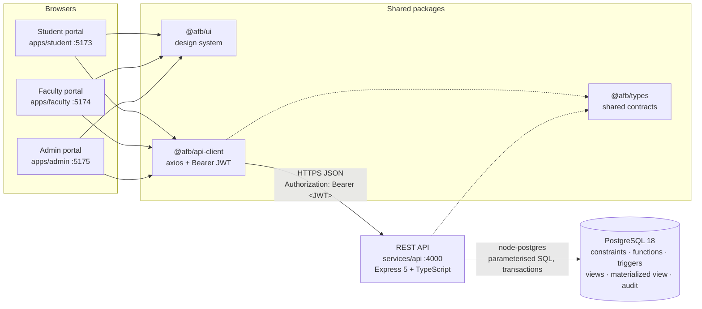

# Architecture

Faculty Appointment Booking System — SRM Institute of Science and Technology
Advanced SQL & Modern Database Features project

This document explains how the system is organised and, for every major decision, **what problem it
solves**. Database internals (tables, constraints, functions, triggers, views) are specified in
[`DATABASE_DESIGN.md`](DATABASE_DESIGN.md); endpoint contracts in [`API_DOCUMENTATION.md`](API_DOCUMENTATION.md).

---

## 1. The problem

Students walk to a staff room to meet a faculty member who may be teaching, in a meeting, on leave or
already with another student. Faculty who handle 500+ students a semester receive requests through
calls, messages and corridor conversations with no single place to see or manage them.

The system gives both sides one source of truth:

- **Students** see a faculty member's genuinely free slots, request one with a purpose, and go to the staff
  room only after the request is approved.
- **Faculty** publish weekly availability and exceptions (leave, meetings), then approve or reject requests.
- **Admins** monitor usage, audit important actions and view reports.

The hardest correctness problem is **double booking**: two students submitting a request for the same
slot at the same moment. The system must stay correct under that race, and that guarantee must come from
PostgreSQL itself — not from application code that happens to check first and insert second.

## 2. System overview



Three separate portals share one design system and one typed client, and talk to one API. The API is the
only component with database credentials.

## 3. Monorepo layout

npm workspaces, TypeScript strict mode everywhere.

| Path                  | Responsibility                                                                                     | Built in    |
| --------------------- | -------------------------------------------------------------------------------------------------- | ----------- |
| `services/api`        | REST API: auth, appointments, availability, admin, reporting. The only DB client.                  | Phase 1 → 8 |
| `apps/student`        | Student portal (React + Vite + Tailwind)                                                           | Phase 6     |
| `apps/faculty`        | Faculty portal                                                                                     | Phase 7     |
| `apps/admin`          | Admin portal                                                                                       | Phase 8     |
| `packages/types`      | Request/response contracts and error codes shared by API and portals. Type-only (no runtime code). | Phase 1 →   |
| `packages/api-client` | Axios instance with Bearer-token interceptor, typed endpoint functions, typed `ApiError`           | Phase 3 →   |
| `packages/ui`         | Shared Tailwind components: layout, forms, tables, toasts, loading/empty/error states              | Phase 6     |
| `database/migrations` | Ordered forward-only SQL migrations                                                                | Phase 2     |
| `database/seeds`      | Initial data, including the four login accounts with bcrypt hashes                                 | Phase 2     |
| `docker/`             | Container build files and PostgreSQL init scripts                                                  | Phase 1, 10 |
| `docs/`               | All project documentation                                                                          | Every phase |

**Why a monorepo:** the API and three portals share contracts. Keeping them in one repository with a
shared `@afb/types` package means a change to a response shape breaks the TypeScript build of every
consumer immediately, instead of breaking a portal at runtime during a demo.

**Why three portals rather than one app with role-based routes:** each role gets a small, focused bundle
and its own login screen that only accepts its own role. A student build contains no faculty or admin
screens at all. The shared `ui` and `api-client` packages keep the three from drifting apart.

## 4. Backend architecture (`services/api`)

### 4.1 Layers

```
HTTP request
   │
   ▼
Router            — maps METHOD + path to a controller method; attaches auth/role middleware
   │
   ▼
Controller        — reads req (params, body, authenticated user), calls ONE service method, writes JSON
   │
   ▼
Service           — business rules and orchestration; owns transactions; knows nothing about HTTP
   │
   ▼
Repository        — the only place SQL is written; parameterised queries; maps rows ⇄ domain objects
   │
   ▼
PostgreSQL 18     — final authority on integrity: constraints, exclusion constraints, triggers, functions
```

| Layer      | May                                                                                                  | Must not                                 |
| ---------- | ---------------------------------------------------------------------------------------------------- | ---------------------------------------- |
| Router     | declare routes, apply `authenticate` / `authorize(role)` / validation middleware                     | contain logic                            |
| Controller | parse and validate input, take the user id **only from the verified JWT**, choose the success status | write SQL, decide error status codes     |
| Service    | enforce business rules, open transactions, combine repositories                                      | touch `req`/`res`, format HTTP responses |
| Repository | run SQL through a `Queryable` (pool or transaction client)                                           | contain business decisions               |

Every repository takes a `Queryable` (`src/db/types.ts`) — satisfied by both `pg.Pool` and a checked-out
`pg.PoolClient`. The same repository method therefore works standalone or inside a transaction the service
controls, without the repository knowing which.

### 4.2 Modules and composition

Each feature lives in `src/modules/<feature>/` with `*.routes.ts`, `*.controller.ts`, `*.service.ts`,
`*.repository.ts` (and `*.schemas.ts` for request validation). `src/routes.ts` is the single composition
root that builds each Repository → Service → Controller chain and mounts it under `/api`. There is no DI
framework: constructors take their dependencies explicitly, which keeps tests simple (pass a fake).

`src/app.ts` builds the Express app **without** listening, so HTTP tests drive it in-process with
Supertest. `src/bootstrap.ts` creates the pool, the app and the HTTP server; `src/server.ts` is the
10-line process entry point.

### 4.3 Request lifecycle

Middleware order in `createApp()`:

1. **Request logger** (`pino-http`) — assigns a request id (reuses a safe incoming `X-Request-Id`, otherwise
   a UUID), echoes it in the `X-Request-Id` response header, logs one line per request.
2. **Security headers** (`helmet`).
3. **CORS** — only the configured portal origins; `Authorization` allowed, `X-Request-Id` exposed. In
   development the portals call the API through the Vite proxy, so requests are same-origin anyway.
4. **JSON body parser** — 100 kB limit.
5. **`/api` routes.**
6. **404 handler** — JSON `ROUTE_NOT_FOUND`, never an HTML page.
7. **Error handler** — the only place errors become HTTP responses.

### 4.4 Error model

Every failure uses one envelope (typed as `ApiErrorBody` in `@afb/types`):

```json
{ "error": { "code": "CONFLICT", "message": "…", "details": { "constraint": "…" }, "requestId": "…" } }
```

Clients branch on `code`, never on `message`. Services throw `AppError` subclasses
(`ValidationError` 400, `UnauthenticatedError` 401, `ForbiddenError` 403, `NotFoundError` 404,
`ConflictError` 409). Unknown errors become a generic 500 — the real error and stack are logged with the
request id, and nothing internal (SQL text, stack traces) is sent to the client.

**PostgreSQL errors are translated by SQLSTATE** (`src/errors/database-error.ts`), because the database is
the final authority and its rejection reason maps to a precise HTTP answer:

| SQLSTATE                                                      | Meaning                                                                         | HTTP      | `code`                                                                               |
| ------------------------------------------------------------- | ------------------------------------------------------------------------------- | --------- | ------------------------------------------------------------------------------------ |
| `23P01`                                                       | exclusion violation (overlapping range)                                         | 409       | `CONFLICT` (domain-specific codes such as `SLOT_CONFLICT` are layered on in Phase 4) |
| `23505`                                                       | unique violation                                                                | 409       | `DUPLICATE`                                                                          |
| `23503`, `23001`                                              | foreign key — referenced row missing / still referenced (`ON DELETE RESTRICT`)  | 400 / 409 | `INVALID_REFERENCE` / `STILL_REFERENCED`                                             |
| `23514`, `23502`                                              | check / not-null violation                                                      | 400       | `VALIDATION_ERROR`                                                                   |
| `22P02`, `22007`, `22008`, `22003`, `22000`                   | malformed value (incl. an inverted range)                                       | 400       | `VALIDATION_ERROR`                                                                   |
| `AB001`–`AB008`                                               | our own booking-rule errors raised by triggers (see `DATABASE_DESIGN.md` § 4.2) | 400 / 409 | e.g. `SLOT_IN_PAST`, `FACULTY_UNAVAILABLE`, `STUDENT_HAS_CLASS`                      |
| `40001`, `40P01`                                              | serialization failure / deadlock                                                | 409       | `TRANSACTION_CONFLICT`                                                               |
| `55P03`                                                       | lock not available                                                              | 409       | `RESOURCE_BUSY`                                                                      |
| `57014`, `57P01`, `57P03`, `53300`, class `08`, socket errors | timeout / server unavailable                                                    | 503       | `DATABASE_UNAVAILABLE`                                                               |

Specific constraints get specific codes and messages before the generic mapping applies — for example
`appointments_no_double_booking` → `409 SLOT_CONFLICT` ("This slot has just been taken by another request").

This mapping is tested twice: against hand-built errors (unit) and against errors raised by a real
PostgreSQL 18 server (integration, `test/integration/database-error.sql.test.ts`).

### 4.5 Configuration, logging, lifecycle

- **Configuration** (`src/config/env.ts`) is validated once at startup with zod. A missing or malformed
  variable stops the process with a message naming every bad variable. `services/api/.env` is loaded with
  Node's built-in `process.loadEnvFile`; real environment variables (Docker, CI) always win.
- **Logging** is structured JSON (pino). The `Authorization` header, cookies and any
  `password` / `token` / `passwordHash` field are redacted before serialisation.
- **Connection pool**: one `pg.Pool` per process, `application_name = 'afb-api'` (identifiable in
  `pg_stat_activity` while demonstrating locks), `statement_timeout = 15 s` so a runaway query cannot hold
  locks indefinitely, and an idle-client error listener so a database restart does not crash the API.
- **Health probes**: `GET /api/health` (liveness, no DB) and `GET /api/health/ready` (readiness: DB
  reachable **and** PostgreSQL ≥ 18, because the schema uses PostgreSQL 18 features). An older server is
  reported as `unsupported_postgres_version` instead of failing later with a cryptic migration error.
- **Background sweep**: once a minute the API calls `process_elapsed_appointments()` (completes approved
  meetings that have ended, expires requests nobody answered). Overlapping runs are skipped; failures are
  logged and retried on the next tick.
- **Graceful shutdown**: SIGINT/SIGTERM stop the sweep and accepting connections, let in-flight requests
  finish, then close the pool.

## 5. Authentication and authorisation

The previous implementation mixed a temporary header-based identity (`X-User-Id` / `X-User-Role`) with
JWTs; which one a request used depended on the code path. This rebuild has exactly **one** identity
mechanism:

1. `POST /api/auth/login` with `{ loginId, password, role? }` — the Registration Number (student), Employee ID
   (faculty) or Admin ID (admin); `role` names the portal, so an account of another role is refused.
2. The API loads the user by login id and compares the password with the stored **bcrypt** hash. Unknown
   user and wrong password return the same `401 UNAUTHENTICATED`, so login ids cannot be enumerated.
3. On success the API signs a JWT containing `sub` (user id) and `role`, and returns it.
4. The portal stores the token and `@afb/api-client` attaches `Authorization: Bearer <token>` to every
   request.
5. `authenticate` middleware verifies the signature and expiry on every protected route and places
   `{ userId, role }` on the request. `authorize(...roles)` enforces the role per route.
6. Controllers take identity **only** from that verified token. No request header, query parameter or
   body field can assert who the caller is.

Only `POST /api/auth/login` and the two health probes are unauthenticated. `routes.ts` mounts
`authenticate` once, after those public routers, so every router mounted below it — including every module
added later — is protected by construction (**default-deny**); even unknown `/api` paths answer 401 without a
token.

Hardening: the token is pinned to HS256 with issuer/audience checks; the account is re-checked on every
request, so deactivating a user ends their sessions immediately; failed logins are rate limited per client
and login ID; unknown login IDs still cost one bcrypt comparison, so timing does not reveal which IDs exist;
the successful login is written to `users.last_login_at` in a transaction attributed to that user, so it
appears in the audit log. Flows are drawn in [`SEQUENCE_DIAGRAM.md`](SEQUENCE_DIAGRAM.md).

## 6. Where business rules live

The database is not a passive store. Each rule is placed where it can be enforced most reliably, and
important rules are enforced in more than one layer (defence in depth).

| Rule                                                                                                     | Frontend                          | API service                                                                   | PostgreSQL                                                    | Why                                                                                                     |
| -------------------------------------------------------------------------------------------------------- | --------------------------------- | ----------------------------------------------------------------------------- | ------------------------------------------------------------- | ------------------------------------------------------------------------------------------------------- |
| No two appointments for the same faculty overlap                                                         | disables taken slots              | catches `23P01`, returns `SLOT_CONFLICT`                                      | **exclusion constraint** on the appointment time range        | Only the database sees all concurrent transactions; an app-level "check then insert" has a race window. |
| A faculty member's weekly availability windows do not overlap                                            | form validation                   | maps the error                                                                | **temporal `WITHOUT OVERLAPS` constraint**                    | Same reason — correctness under concurrency.                                                            |
| A request must fall inside availability and outside exceptions, classes and existing bookings            | shows only computed free slots    | calls the DB function inside the booking transaction                          | **stored function** computing free slots                      | One definition of "free", used by both search and booking.                                              |
| Valid status transitions (pending → approved/rejected/cancelled, approved → completed/…)                 | shows only allowed actions        | checks ownership and role                                                     | **trigger** rejects illegal transitions                       | Nothing — not even a manual SQL update — can put an appointment in an impossible state.                 |
| A student may cancel only their own pending request; a faculty member may act only on their own requests | hides others' actions             | **ownership check using the JWT user id**, enforced in the SQL `WHERE` clause | row filtered by owner                                         | Identity comes from the token, never from input.                                                        |
| Important actions are traceable                                                                          | —                                 | —                                                                             | **audit triggers** write `audit_logs` in the same transaction | An audit row exists if and only if the change committed.                                                |
| Input formats (dates, lengths, required fields)                                                          | form validation for fast feedback | **zod validation** → 400                                                      | `CHECK` / `NOT NULL` as the final guard                       | Friendly errors early; integrity guaranteed at the bottom.                                              |
| Passwords are never stored in plain text                                                                 | —                                 | **bcrypt** hash/compare                                                       | stores only the hash                                          | Hashing belongs to the application, which holds the cost parameter and the library.                     |

The concrete constraints, functions and triggers are specified in `DATABASE_DESIGN.md` (Phase 2).

## 7. Frontend architecture (Phases 6–8)

- **Three Vite + React + TypeScript apps** with React Router, styled with Tailwind CSS.
- **`@afb/ui`** provides the common design language: portal shell and navigation, form controls with
  validation messages, data tables, cards, badges, toasts, and explicit loading / empty / error states.
- **`@afb/api-client`** provides a configured Axios instance: base URL `/api`, the Bearer-token request
  interceptor, and a response interceptor that turns the error envelope into a typed `ApiError` and
  signs the user out on `401`.
- In development each Vite server proxies `/api` to `http://localhost:4000`, so the browser only ever
  talks to its own origin. For a LAN demo, `vite --host` exposes the portal on the network while the proxy
  keeps API calls same-origin.
- Every page is backed by a real endpoint. No screen is built for data the API cannot provide.

## 8. Data access: node-postgres and hand-written SQL, no ORM

The project exists to demonstrate PostgreSQL: exclusion and temporal constraints, CTEs, window functions,
stored functions, triggers, row locking, isolation levels, materialized views and `EXPLAIN ANALYZE`. An
ORM would hide exactly the SQL we need to show and defend. `pg` (node-postgres) gives direct access to
parameterised SQL, transactions and PostgreSQL error codes, with nothing in between. All queries use
placeholders (`$1`, `$2`, …), which rules out SQL injection by construction.

## 9. Testing strategy

| Level             | Tool                               | What it proves                                                                        |
| ----------------- | ---------------------------------- | ------------------------------------------------------------------------------------- |
| Unit              | Jest                               | Services, error mapping, config, middleware in isolation (fakes for repositories)     |
| Integration / SQL | Jest + real PostgreSQL 18          | Repositories, constraints, functions and triggers behave as designed on a real server |
| HTTP              | Jest + Supertest + real PostgreSQL | Full request → response through every middleware, including auth                      |
| Concurrency       | Jest + parallel connections        | Simultaneous bookings for one slot: exactly one succeeds                              |
| Frontend          | Vitest + Testing Library           | Pages render real API states (loading, empty, error, success)                         |

Integration tests use a separate `advanced_faculty_booking_test` database, never development data.
Coverage thresholds are enforced by Jest: **100 % statements, functions and lines** (branches ≥ 95 %).
Only `src/server.ts` (the process entry point) and type-only modules are excluded.

## 10. Technology decisions

| Decision                               | Problem it solves                                                                                                                                    | Alternatives considered                                                                |
| -------------------------------------- | ---------------------------------------------------------------------------------------------------------------------------------------------------- | -------------------------------------------------------------------------------------- |
| PostgreSQL 18                          | Temporal `WITHOUT OVERLAPS` constraints, `uuidv7()`, virtual generated columns and `RETURNING OLD/NEW` directly support the core scheduling problems | PostgreSQL 16/17 would force manual workarounds for each                               |
| Express 5                              | Rejected promises in async handlers reach the error handler automatically — no wrapper boilerplate                                                   | Express 4 (needs wrappers), Fastify (less familiar to the team)                        |
| TypeScript 6.0 (strict)                | Compile-time contracts across API and portals                                                                                                        | TypeScript 7 (native compiler) is not yet supported by `ts-jest` / `typescript-eslint` |
| Jest + Supertest (API)                 | Required stack; `projects` separate unit from DB-backed tests                                                                                        | —                                                                                      |
| Vitest (portals)                       | Shares Vite's config and transforms, so frontend tests need no separate build setup                                                                  | Jest for the frontend would need its own JSX/ESM configuration                         |
| zod                                    | One declaration gives runtime validation and the TypeScript type                                                                                     | Hand-written validation (duplicated, error-prone)                                      |
| pino                                   | Fast structured logs with built-in redaction                                                                                                         | `console.log` (unstructured, no redaction)                                             |
| Docker Compose                         | Everyone on the team runs the same PostgreSQL 18, independent of what is installed locally                                                           | Local installs (version drift between laptops)                                         |
| Ports 4000 (API) and 5433 (PostgreSQL) | Avoid clashing with the previous implementation (3000) or a local PostgreSQL (5432) running on the same laptop                                       | Defaults                                                                               |

## 11. What changed from the previous implementation

The previous system was discarded because its identity model was inconsistent (temporary header identity
alongside JWT). This rebuild keeps the project's ideas — the scheduling domain, the double-booking
guarantee, database-enforced rules — and changes the foundation:

- One identity mechanism (JWT from Registration Number / Employee ID / Admin ID + bcrypt). No identity headers.
- One error envelope and one SQLSTATE translation layer shared by every module.
- Every protected route declares its allowed roles next to its path.
- PostgreSQL 18 native temporal constraints instead of hand-assembled equivalents.
- Contracts shared at compile time through `@afb/types`.
