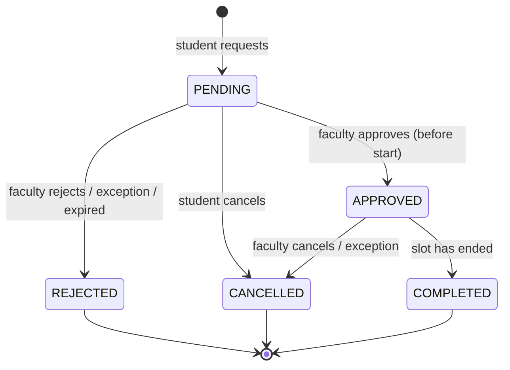

# Database Design

PostgreSQL 18 · schema defined in `database/migrations/0001`–`0007` · diagram in [`ER_DIAGRAM.md`](ER_DIAGRAM.md)

The database is the core of this system, not a passive store. It **decides** whether a time slot is
bookable, **guarantees** that no slot is ever double-booked (even under simultaneous requests),
**enforces** the appointment lifecycle, **notifies** the people involved, **audits** every change and
**produces** the reports. The API validates input and handles identity; it never re-implements a rule
that PostgreSQL already guarantees.

---

## 1. Design principles

1. **The final guard lives in the database.** Anything that must hold regardless of which code path wrote
   the data — including a teammate running SQL by hand — is a constraint or trigger, not an `if` in the API.
2. **One definition per rule.** "Bookable" is defined once (`faculty_free_slots` / `check_appointment_request`);
   "no double booking" is defined once (an exclusion constraint).
3. **Correct under concurrency by construction.** Rules that depend on _other rows_ (overlaps) are
   enforced with constraints backed by indexes, which PostgreSQL checks atomically — never with
   "SELECT, then INSERT" logic that has a race window.
4. **Normalised storage, derived read models.** Tables are in 3NF. Derived values are either generated
   columns (always consistent with their source) or explicit read models (a view and a materialized view).
5. **Every object has a reason to exist.** Each table, index, function and trigger below states the problem
   it solves.

## 2. Tables

### 2.1 People and structure

| Table         | Purpose                                                  | Key constraints                                                                                                                                                                                               |
| ------------- | -------------------------------------------------------- | ------------------------------------------------------------------------------------------------------------------------------------------------------------------------------------------------------------- |
| `departments` | Academic departments (CSE, …)                            | `code` unique and upper-case (`^[A-Z]{2,10}$`); `name` unique and non-blank                                                                                                                                   |
| `batches`     | A cohort sharing one weekly timetable                    | unique `(department_id, academic_year, year_of_study, name)`; `academic_year` must be two consecutive years (`2026-2027`)                                                                                     |
| `users`       | Everyone who can log in                                  | `login_id` unique; **login id shape matches role** (`RA…` student, `FAC…` faculty, `ADMIN…` admin); **`password_hash` must be a bcrypt hash** (regex CHECK); `UNIQUE (id, role)` as the target of subtype FKs |
| `students`    | Student details (Registration Number = `users.login_id`) | PK = `user_id`; composite FK `(user_id, role) → users (id, role)` with `role` pinned to `STUDENT`                                                                                                             |
| `faculty`     | Faculty details (Employee ID = `users.login_id`)         | same subtype pattern with `FACULTY`; `slot_minutes` 10–60 on a 5-minute grid                                                                                                                                  |

**Why a subtype pattern.** Students and faculty share login, name, password and status, but have
different attributes. One `users` table keeps authentication in one place (one login query for all
three portals). The composite foreign key `(user_id, role)` is the notable part: a plain
`user_id → users(id)` would allow a faculty member's user id to appear in `students`. Referencing
`(id, role)` and pinning `role` with a CHECK makes that impossible, and also blocks changing a user's role
while the subtype row exists. Admins have no extra attributes, so they need no subtype table.

**Why a CHECK for bcrypt.** The API hashes passwords, but "passwords are stored only as bcrypt hashes"
should not depend on every future code path remembering to hash. The CHECK
`password_hash ~ '^\$2[aby]\$(0[4-9]|[12][0-9]|3[01])\$[./A-Za-z0-9]{53}$'` makes storing a plaintext
password impossible.

### 2.2 Schedules

| Table                         | Purpose                                                      | Key constraints                                                                                            |
| ----------------------------- | ------------------------------------------------------------ | ---------------------------------------------------------------------------------------------------------- |
| `batch_schedule`              | Weekly classes of each batch; `faculty_id` marks who teaches | `UNIQUE (batch_id, day_of_week, during WITHOUT OVERLAPS)` — a batch never has two overlapping classes      |
| `faculty_availability`        | Weekly windows when a faculty member meets students          | `UNIQUE (faculty_id, day_of_week, during WITHOUT OVERLAPS)`; times on a 5-minute grid; end before midnight |
| `faculty_schedule_exceptions` | One-off unavailability: leave, meetings, blocked time        | finite half-open `tstzrange`, at most 31 days; cannot be created for a period that has already ended       |

**One table, two meanings.** `batch_schedule` is both the students' class timetable and the faculty
members' teaching timetable (via `faculty_id`). One row per class means a faculty member's teaching hours
and the batch's class hours can never disagree.

**Weekly vs. absolute time.** Weekly rows store _local_ time-of-day (`time`, campus time zone) because
"Mondays 14:00–16:00" is a local concept. Exceptions and appointments happen once, so they store absolute
instants (`tstzrange`). `campus_timestamp(date, time)` converts between the two with the zone named
explicitly (`campus_timezone()` = `Asia/Kolkata`), so results never depend on the server's time zone.

**`timerange`.** PostgreSQL has ranges for numbers, dates and timestamps, but not for `time`. We define
`CREATE TYPE timerange AS RANGE (subtype = time, subtype_diff = time_subtype_diff)`, so weekly intervals
can use range operators (`&&` overlaps, `@>` contains) and GiST indexes. The `during` column is a
**stored generated column** (`timerange(start_time, end_time, '[)')`): computed by PostgreSQL, impossible to
get out of sync with `start_time`/`end_time`. `faculty_availability.duration_minutes` is a PostgreSQL 18
**virtual generated column**: computed on read, occupying no storage. (PostgreSQL 18 does not allow virtual
columns over user-defined types, which is why `during` is stored.)

**`WITHOUT OVERLAPS` (PostgreSQL 18).** Temporal primary/unique keys: `UNIQUE (faculty_id, day_of_week,
during WITHOUT OVERLAPS)` means "for the same faculty member and weekday, no two `during` ranges overlap".
PostgreSQL implements it as an exclusion constraint on a GiST index. Half-open ranges (`[)`) make
back-to-back windows (10:00–11:00 and 11:00–12:00) legal.

### 2.3 Appointments and notifications

`appointments` holds requests and their lifecycle: `slot` (`tstzrange`), `purpose`, `status`, and the
timestamps and note that each outcome records. Its id is a **`uuidv7()`** (new in PostgreSQL 18): not
guessable like 1, 2, 3, yet time-ordered, so inserts still append to the right edge of the primary-key index.

Cross-column CHECK constraints keep status and timestamps consistent even for hand-written SQL:

| Constraint                                            | Rule                                                           |
| ----------------------------------------------------- | -------------------------------------------------------------- |
| `appointments_pending_has_no_outcome`                 | a PENDING row has no decision, cancellation or completion time |
| `appointments_decision_recorded`                      | APPROVED, REJECTED and COMPLETED rows have `decided_at`        |
| `appointments_cancellation_recorded`                  | `cancelled_at` is set **if and only if** status is CANCELLED   |
| `appointments_completion_recorded`                    | `completed_at` is set **if and only if** status is COMPLETED   |
| `appointments_slot_valid`, `appointments_slot_length` | finite half-open slot of 10–60 minutes                         |
| `appointments_purpose_length`                         | 10–500 characters after trimming                               |

`notifications` stores in-app messages written by triggers (§ 5).

### 2.4 `audit_logs`

Append-only change history for every business table (§ 6). No foreign key to `users`, deliberately:
the log must outlive the rows it describes.

## 3. Double-booking prevention

```sql
CONSTRAINT appointments_no_double_booking
  EXCLUDE USING gist (faculty_id WITH =, slot WITH &&)
  WHERE (status IN ('PENDING', 'APPROVED'))
```

Read: _no two rows with equal `faculty_id` and overlapping `slot` may both be pending or approved._

- **Why an exclusion constraint.** A UNIQUE constraint only detects _equal_ values; appointments conflict
  when they _overlap_. An exclusion constraint generalises uniqueness to any operator — here `=` on the
  faculty and `&&` (overlaps) on the time range. `btree_gist` lets one GiST index combine both.
- **Why it is race-free.** Suppose four students submit 11:40–11:55 with Prof. Rao at the same moment. All
  four `INSERT`s reach the GiST index. The first inserts its entry; the others find a conflicting entry from
  a transaction that has not committed yet, so they **wait** for it. When it commits, each waiting insert
  fails with SQLSTATE `23P01`. Exactly one request succeeds — no application lock, no retry loop, no window
  between "check" and "insert".
- **Why partial (`WHERE status IN …`).** A rejected or cancelled request must release its slot. Only
  active rows participate in the constraint.
- A second constraint, `appointments_student_no_overlap`, applies the same idea to students: nobody can
  hold two overlapping active appointments with different faculty.

**The contrast with a basic DBMS implementation** is demonstrated by
`test/integration/sql/concurrency.sql.test.ts`: with a typical "`SELECT` to check, then `INSERT`" and four
concurrent connections, all four bookings succeed (the slot is quadruple-booked). With the exclusion
constraint, exactly one of four succeeds and the other three receive `23P01`, which the API returns as
`409 SLOT_CONFLICT`.

## 4. Booking rules

### 4.1 `faculty_free_slots(faculty_id, from_date, to_date, student_id DEFAULT NULL)`

The single definition of "bookable", used to list slots to students. A SQL function built from CTEs:

1. **`active_faculty`** — the faculty member (if active) and their slot length.
2. **`days`** — `generate_series` of local dates, clipped to _today … today + 30 days_ (the booking horizon).
3. **`candidates`** — each weekly availability window on each matching weekday, cut into slots with a
   `LATERAL generate_series(window_start, window_end − slot, slot)`.
4. The final `SELECT` removes, with `NOT EXISTS` sub-queries, every candidate that is in the past, overlaps
   an exception, overlaps the faculty member's own teaching, or overlaps an active appointment. With a
   `student_id` it also removes the student's class hours and the student's other active appointments —
   a student is only offered times they can actually attend.

### 4.2 `check_appointment_request` and the INSERT trigger

`BEFORE INSERT ON appointments` calls `check_appointment_request(faculty, student, slot)`, which raises a
specific, user-readable error for each way a request can be invalid. The API maps each application
SQLSTATE (class `AB`, unused by PostgreSQL) to an HTTP response:

| SQLSTATE                                     | Meaning                                                                              | Example message                                                           | API                             |
| -------------------------------------------- | ------------------------------------------------------------------------------------ | ------------------------------------------------------------------------- | ------------------------------- |
| `AB001`                                      | slot is not in the future                                                            | "Appointments can only be requested for a future time."                   | 400 `SLOT_IN_PAST`              |
| `AB007`                                      | beyond the 30-day horizon                                                            | "Appointments can be requested at most 30 days in advance."               | 400 `SLOT_BEYOND_HORIZON`       |
| `AB002`                                      | not one of the faculty member's slots (wrong length, off-grid, outside availability) | "The selected time is not one of Prof. K. Rao's appointment slots."       | 409 `SLOT_NOT_OFFERED`          |
| `AB003`                                      | faculty unavailable (exception, teaching, inactive)                                  | "Prof. K. Rao is teaching Computer Networks at this time."                | 409 `FACULTY_UNAVAILABLE`       |
| `AB004`                                      | the student has a class                                                              | "You have a class (Compiler Design) at this time."                        | 409 `STUDENT_HAS_CLASS`         |
| `AB005`                                      | illegal status transition                                                            | "This appointment is already rejected; it cannot be changed to approved." | 409 `INVALID_STATUS_TRANSITION` |
| `AB006`                                      | participants / time / purpose changed after creation                                 | —                                                                         | 409 `APPOINTMENT_IMMUTABLE`     |
| `AB008`                                      | exception period already over                                                        | "This period has already ended."                                          | 400 `PERIOD_ALREADY_ENDED`      |
| `23P01` on `appointments_no_double_booking`  | slot already held                                                                    | "This slot has just been taken by another request…"                       | 409 `SLOT_CONFLICT`             |
| `23P01` on `appointments_student_no_overlap` | student already busy                                                                 | "You already have an appointment at this time."                           | 409 `STUDENT_SCHEDULE_CONFLICT` |

Overlap with _other appointments_ is deliberately **not** checked in the trigger: the exclusion
constraints are the single, race-free authority for that.

### 4.3 Lifecycle



`BEFORE UPDATE ON appointments` enforces this diagram, refuses approval after the start time and completion
before the end time, stamps `decided_at` / `cancelled_at` / `completed_at`, and rejects any change to
student, faculty, slot or purpose (rescheduling = cancel and request again, so history stays truthful).

### 4.4 Automatic actions

| Trigger / function                        | When                                                                                   | What it does                                                                                                                                                                                 |
| ----------------------------------------- | -------------------------------------------------------------------------------------- | -------------------------------------------------------------------------------------------------------------------------------------------------------------------------------------------- |
| `appointments_notify`                     | after insert / status change                                                           | Writes a notification for the other party ("New appointment request", "Appointment approved", …), with local date and time and any note.                                                     |
| `faculty_exceptions_release_appointments` | after an exception is inserted                                                         | Upcoming PENDING requests in the period become REJECTED and APPROVED ones CANCELLED, with the reason — which in turn fires the notification and audit triggers, all in the same transaction. |
| `process_elapsed_appointments()`          | called by the API once a minute (scheduler added with the appointment module, Phase 4) | Two data-modifying CTEs in one statement: APPROVED appointments that have ended become COMPLETED; PENDING requests whose time arrived unanswered become REJECTED ("Expired: …"). Idempotent. |

### 4.5 The business clock

Every time-dependent rule reads `app_now()`, which is `now()` unless a test pins it with
`SET LOCAL app.now = '…'`. Tests therefore verify "cannot book in the past" or "complete after the end"
deterministically, on fixed dates, without waiting. The API never sets `app.now`.

## 5. Notifications

Notifications are written by triggers in the same transaction as the change they describe, so a student
is never told "approved" about an approval that rolled back, and no code path can forget to notify.
`notifications_user_unread_idx` is a **partial index** on unread rows only: the unread badge stays cheap
however much history accumulates.

## 6. Audit logging

`audit_row_change()` is one generic `AFTER INSERT OR UPDATE OR DELETE` trigger attached to all nine
business tables. For each change it stores the table, record id, action, old and new row as `jsonb`,
the exact list of changed columns, the transaction id (`xid8`) and the actor.

- **Actor.** The API starts every write transaction with
  `set_config('app.user_id', …, true)` and `set_config('app.user_role', …, true)` (transaction-local).
  Changes made outside the API (migrations, seed, psql) have a NULL actor — "system".
- **Secrets.** `password_hash` is removed from `old_data`/`new_data`; a password change still appears in
  `changed_fields`.
- **Noise.** Updates that change nothing except `updated_at` are not logged.
- **Tamper resistance.** `BEFORE UPDATE OR DELETE` (row) and `BEFORE TRUNCATE` (statement) triggers reject
  any modification: the log is append-only.
- **Atomicity.** Written by a trigger inside the same transaction, an audit row exists if and only if the
  change committed.

## 7. Read models

- **`appointment_details` (view)** — appointments joined with student, batch, faculty and department. Every
  list endpoint selects from it, so the six-table join exists once.
- **`faculty_monthly_report` (materialized view)** — per faculty member and month: totals by status, average
  response time (minutes from request to decision), approval rate, and window-function columns:
  `RANK() OVER (PARTITION BY department, month ORDER BY total DESC)` (demand rank),
  `total − LAG(total) OVER (PARTITION BY faculty ORDER BY month)` (change from previous month) and
  `SUM(total) OVER (PARTITION BY faculty ORDER BY month ROWS UNBOUNDED PRECEDING)` (running total).
  It is materialized because it aggregates the entire history; `refresh_reports()` runs
  `REFRESH MATERIALIZED VIEW CONCURRENTLY` (enabled by the unique index on `(faculty_id, month)`), so readers
  are never blocked during a refresh.

## 8. Index strategy

Every index answers a specific query. Constraint-backing indexes are listed too, because they are what
make the constraints fast.

| Index                                                | Type                                                    | Serves                                                                            |
| ---------------------------------------------------- | ------------------------------------------------------- | --------------------------------------------------------------------------------- |
| `appointments_no_double_booking`                     | GiST `(faculty_id, slot)`, partial                      | double-booking check; "is this faculty slot taken?"                               |
| `appointments_student_no_overlap`                    | GiST `(student_id, slot)`, partial                      | student overlap check                                                             |
| `appointments_student_recent_idx`                    | B-tree `(student_id, created_at DESC)`                  | student "My Appointments", newest first                                           |
| `appointments_faculty_status_start_idx`              | B-tree `(faculty_id, status, lower(slot))` — expression | faculty pending queue, today's schedule, history, ordered by start time           |
| `faculty_availability_no_overlap`                    | GiST (from `WITHOUT OVERLAPS`)                          | temporal uniqueness; availability lookups by faculty and weekday                  |
| `batch_schedule_no_overlap`                          | GiST (from `WITHOUT OVERLAPS`)                          | temporal uniqueness; "does the student's batch have a class then?"                |
| `batch_schedule_teaching_idx`                        | GiST `(faculty_id, day_of_week, during)`, partial       | "is the faculty member teaching then?"                                            |
| `faculty_schedule_exceptions_lookup_idx`             | GiST `(faculty_id, period)`                             | "does an exception overlap this slot?"                                            |
| `users_full_name_trgm_idx`                           | GIN `gin_trgm_ops`                                      | faculty search by name substring (`ILIKE '%rao%'`)                                |
| `notifications_user_recent_idx`                      | B-tree `(user_id, created_at DESC)`                     | notification list                                                                 |
| `notifications_user_unread_idx`                      | B-tree `(user_id)`, partial `WHERE read_at IS NULL`     | unread count                                                                      |
| `audit_logs_occurred_at_brin`                        | **BRIN**                                                | time-range filters on the append-only log (tiny index; rows arrive in time order) |
| `audit_logs_record_idx`                              | B-tree `(table_name, record_id)`                        | history of one record                                                             |
| `audit_logs_actor_idx`                               | B-tree, partial (`actor_user_id IS NOT NULL`)           | "what did this user do"                                                           |
| `students_batch_id_idx`, `faculty_department_id_idx` | B-tree                                                  | foreign-key joins and `ON DELETE` checks                                          |

Query plans with `EXPLAIN ANALYZE` on realistic data volumes are documented in Phase 10.

## 9. Transactions and isolation

- **`withTransaction()`** (`services/api/src/db/transaction.ts`) runs a unit of work on one connection:
  `BEGIN` at the chosen isolation level, set the audit actor, run, `COMMIT` — or `ROLLBACK` on any error.
- **READ COMMITTED** (default) suffices for bookings: the exclusion constraint, not the isolation level,
  prevents double booking.
- **SERIALIZABLE** is available for read-then-write logic whose correctness depends on what was read.
  Serialization failures (`40001`) and deadlocks (`40P01`) are retried automatically from the beginning.
  `test/integration/db/transaction.test.ts` demonstrates this with the classic write-skew example: two
  transactions each see two faculty on duty and each takes a different one off; PostgreSQL aborts one, the
  retry sees only one on duty and backs off, and the invariant holds.

## 10. Migrations and seed

- **Migrations** (`database/migrations/NNNN_name.sql`) are applied in order by `Migrator`
  (`services/api/src/db/migrator.ts`). Each file runs in its own transaction together with its row in
  `schema_migrations`. An advisory lock prevents two processes migrating at once. Applied files are
  SHA-256 checksummed (line-ending independent); editing an applied migration is reported as an error.
- **Seed** (`database/seeds/seed-data.json`): one department, two batches with full weekly timetables,
  faculty availability and exactly four accounts. Passwords in the file are the documented demo
  credentials; the seeder bcrypt-hashes them (cost 12) before inserting. The whole seed is one transaction
  (visible in `audit_logs` as one `transaction_id`), and it runs only on a database without users.

| Command (repository root) | Effect                                                 |
| ------------------------- | ------------------------------------------------------ |
| `npm run db:migrate`      | apply pending migrations                               |
| `npm run db:seed`         | load the seed into an empty database                   |
| `npm run db:setup`        | migrate + seed (safe to repeat)                        |
| `npm run db:status`       | list migrations and whether each is applied            |
| `npm run db:fresh`        | drop everything, migrate, seed (refused in production) |
| `npm run db:reset`        | drop everything (refused in production)                |

## 11. Advanced SQL features and where they are used

| Feature                                                       | Where                                                                                           | Problem it solves                                           |
| ------------------------------------------------------------- | ----------------------------------------------------------------------------------------------- | ----------------------------------------------------------- |
| Exclusion constraints (GiST, partial)                         | `appointments_no_double_booking`, `appointments_student_no_overlap`                             | race-free prevention of overlapping bookings                |
| Temporal `WITHOUT OVERLAPS` (PG 18)                           | `faculty_availability`, `batch_schedule`                                                        | no overlapping weekly windows / classes                     |
| Range types, custom range type                                | `tstzrange` slots and exceptions; `timerange`                                                   | overlap/containment logic with operators and indexes        |
| Generated columns (stored + virtual, PG 18)                   | `during`, `duration_minutes`                                                                    | derived values that cannot drift                            |
| `uuidv7()` (PG 18)                                            | appointment and notification ids                                                                | non-enumerable, index-friendly ids                          |
| Composite FKs for subtypes                                    | `students`, `faculty`                                                                           | role-consistent subtype rows                                |
| CHECK constraints (incl. cross-column, regex)                 | everywhere                                                                                      | data rules no code path can bypass                          |
| CTEs, `LATERAL`, `generate_series`                            | `faculty_free_slots`                                                                            | computing free slots in one query                           |
| Data-modifying CTEs                                           | `process_elapsed_appointments`                                                                  | two state transitions in one atomic statement               |
| Stored functions (SQL and PL/pgSQL)                           | free slots, request validation, elapsed processing, report refresh                              | one authoritative implementation of each rule               |
| Triggers (row and statement)                                  | validation, lifecycle, notifications, exception release, audit, append-only guard, `updated_at` | automatic, atomic side effects                              |
| Custom SQLSTATEs                                              | `AB001`–`AB008`                                                                                 | precise, user-readable errors mapped to HTTP                |
| Window functions                                              | `faculty_monthly_report` (`RANK`, `LAG`, running `SUM`)                                         | comparative reporting                                       |
| Materialized view + concurrent refresh                        | `faculty_monthly_report`                                                                        | fast reports without blocking readers                       |
| Views                                                         | `appointment_details`                                                                           | one definition of the list shape                            |
| GiST, GIN (trigram), BRIN, partial and expression indexes     | § 8                                                                                             | each serves a named query                                   |
| Transactions, isolation levels, retry                         | `withTransaction`, migrator, seeder                                                             | atomic units of work; SERIALIZABLE where needed             |
| Advisory locks                                                | migrator                                                                                        | one migration run at a time                                 |
| Transaction-local settings                                    | audit actor, business clock                                                                     | pass context to triggers without extra columns              |
| JSONB                                                         | audit `old_data` / `new_data`; `jsonb_to_recordset` for the weekly-availability set             | generic change history; set-based diff of submitted windows |
| Set-returning function in a `LEFT JOIN` + `json_agg … FILTER` | free slots grouped per day (`FacultyRepository.freeSlotsByDay`)                                 | every date in a range with its slots, in one query          |
| `LATERAL` join to a function                                  | next free slot per faculty member in the directory                                              | earliest bookable slot for each row without N+1 queries     |
| Trigram similarity ranking                                    | faculty search (`similarity(full_name, term)`)                                                  | typo-tolerant, index-backed name search                     |
