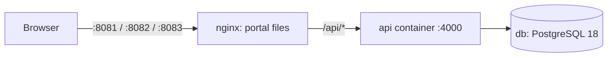

# Deployment

The whole system runs in Docker with one command. Five containers are started: PostgreSQL 18, the API and
one nginx container for each portal.

```bash
docker compose up --build
```

| URL                                      | What                                                | Sign in as                            |
| ---------------------------------------- | --------------------------------------------------- | ------------------------------------- |
| <http://localhost:8081>                  | Student portal                                      | `RA221100301001` / `Password123!`     |
| <http://localhost:8082>                  | Faculty portal                                      | `FAC200` or `FAC201` / `Password123!` |
| <http://localhost:8083>                  | Admin portal                                        | `ADMIN001` / `Admin123!`              |
| <http://localhost:4000/api/health/ready> | API readiness (database reachable, PostgreSQL ≥ 18) | —                                     |

The first build takes a few minutes (it installs dependencies and builds four images). Later starts take a few
seconds. `docker compose up --build -d` runs everything in the background; `docker compose logs -f api` follows
the API log; `docker compose down` stops it (data is kept in the `pgdata` volume); `docker compose down -v` also
deletes the data.

## What happens on start-up



1. **db** — `postgres:18` starts; on its very first start the init script in `docker/postgres/init` also creates
   the test database. Its health check (`pg_isready`) gates the API.
2. **api** — the entrypoint (`docker/api-entrypoint.sh`) runs `node dist/db/cli.js setup`: pending migrations
   are applied (checksummed, under an advisory lock) and the seed is loaded **only if the database has no
   users**, so restarts never duplicate or overwrite data. Then `node dist/server.js` starts, together with the
   one-minute sweep that completes finished meetings and expires unanswered requests. The container's health
   check calls `/api/health/ready`.
3. **student / faculty / admin** — each serves its Vite production build with nginx and forwards `/api/*` to
   the API container. The browser only ever talks to one origin, so no CORS configuration is needed in
   practice, and each portal can be put behind its own domain name later.

## Configuration

Every setting has a default; to change any of them, copy `.env.example` (repository root) to `.env`:

| Variable                                              | Default                                    | Meaning                                                                                                                                                                         |
| ----------------------------------------------------- | ------------------------------------------ | ------------------------------------------------------------------------------------------------------------------------------------------------------------------------------- |
| `POSTGRES_USER` / `POSTGRES_PASSWORD` / `POSTGRES_DB` | `afb` / `afb` / `advanced_faculty_booking` | Database credentials (the API's `DATABASE_URL` is built from them)                                                                                                              |
| `POSTGRES_PORT`                                       | `5433`                                     | Host port of PostgreSQL (5433 avoids a local PostgreSQL on 5432)                                                                                                                |
| `JWT_SECRET`                                          | _empty_                                    | Signing key for login tokens, 32+ characters. Empty = a random key is generated at each start (everyone is signed out when the API restarts). Set it for anything longer-lived. |
| `JWT_EXPIRES_IN`                                      | `8h`                                       | Session length                                                                                                                                                                  |
| `API_PORT`                                            | `4000`                                     | Host port of the API                                                                                                                                                            |
| `STUDENT_PORT` / `FACULTY_PORT` / `ADMIN_PORT`        | `8081` / `8082` / `8083`                   | Host ports of the portals                                                                                                                                                       |
| `BCRYPT_COST`                                         | `12`                                       | bcrypt work factor for passwords hashed by the seed                                                                                                                             |
| `LOG_LEVEL`                                           | `info`                                     | API log level (`debug`, `info`, `warn`, `error`)                                                                                                                                |

Generate a secret with `node -e "console.log(require('crypto').randomBytes(48).toString('base64url'))"`.
The API refuses to start in production with the example secret from `services/api/.env.example`.

## Images

| Image                                     | Dockerfile                                    | Contents                                                                                                                                                                                                    |
| ----------------------------------------- | --------------------------------------------- | ----------------------------------------------------------------------------------------------------------------------------------------------------------------------------------------------------------- |
| `afb-api`                                 | `docker/api.Dockerfile`                       | Two stages: TypeScript is compiled in a build stage; the runtime stage has only production dependencies, the compiled JavaScript and `database/` (migrations + seed). Runs as the unprivileged `node` user. |
| `afb-student`, `afb-faculty`, `afb-admin` | `docker/web.Dockerfile` (`--build-arg APP=…`) | Vite production build served by `nginx:alpine` with `docker/nginx/portal.conf`: SPA fallback, `/api` proxy, one-year caching for hashed assets, no caching for `index.html`, security headers.              |

Build one image on its own, for example:

```bash
docker build -f docker/api.Dockerfile -t afb-api .
docker build -f docker/web.Dockerfile --build-arg APP=faculty -t afb-faculty .
```

## Operations

| Task                               | Command                                                                                           |
| ---------------------------------- | ------------------------------------------------------------------------------------------------- |
| Status of all containers           | `docker compose ps`                                                                               |
| API log                            | `docker compose logs -f api`                                                                      |
| SQL shell                          | `docker exec -it afb-postgres psql -U afb -d advanced_faculty_booking`                            |
| Applied migrations                 | `docker compose exec api node dist/db/cli.js status`                                              |
| Back up the database               | `docker exec afb-postgres pg_dump -U afb -Fc advanced_faculty_booking > backup.dump`              |
| Restore a backup                   | `docker exec -i afb-postgres pg_restore -U afb -d advanced_faculty_booking --clean < backup.dump` |
| Start again from an empty database | `docker compose down -v && docker compose up --build`                                             |
| Refresh the monthly report         | Admin portal → Reports → **Refresh now** (or `SELECT refresh_reports();`)                         |

## Development setup (without the API and portal containers)

See the [README](../README.md#getting-started): `npm run db:up` starts only PostgreSQL, and `npm run dev:api`,
`dev:student`, `dev:faculty` and `dev:admin` run the rest with hot reload on ports 4000 and 5173–5175.

## Production checklist

The Compose file is ready for a demonstration or a single server. Before real users rely on it:

- Set a strong `JWT_SECRET` and a non-default `POSTGRES_PASSWORD` in `.env`.
- Put a TLS-terminating reverse proxy (or a cloud load balancer) in front of the portals; keep the API port
  (`4000`) and PostgreSQL port (`5433`) closed to the internet — the portals reach the API over the internal
  Docker network.
- Replace the demo data: this project has no account-registration screen (accounts come from the college's
  records), so load real departments, batches, timetables and accounts with an SQL import or a custom seed file
  (`DATABASE_DIR` points the API at a different `database/` folder), then deactivate the demo accounts from the
  admin portal.
- Schedule `pg_dump` backups and test a restore.
