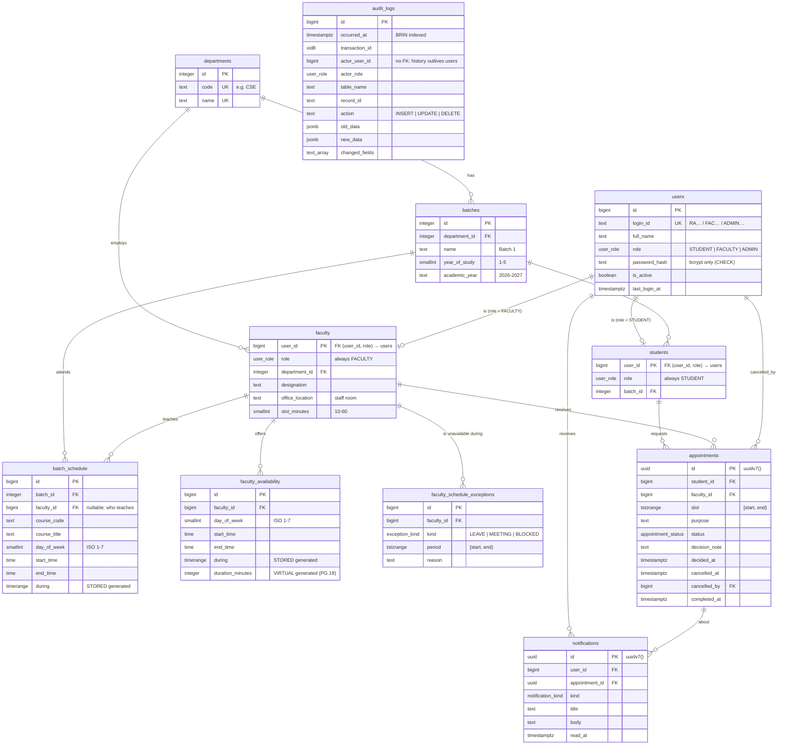

# Entity–Relationship Diagram

The diagram reflects the schema created by `database/migrations/0001`–`0007`. Column-level constraints,
indexes and the reasoning behind them are in [`DATABASE_DESIGN.md`](DATABASE_DESIGN.md).

`audit_logs` has no relationship lines on purpose: it records changes to every other table generically
(by table name and record id) and must keep its history even after the rows it describes are deleted.

## Relationship notes

| Relationship                       | Cardinality      | Enforced by                                                                                                                                                                                                    |
| ---------------------------------- | ---------------- | -------------------------------------------------------------------------------------------------------------------------------------------------------------------------------------------------------------- |
| user → student / faculty           | 1 : 0..1         | Composite FK `(user_id, role) → users (id, role)` plus `CHECK (role = 'STUDENT')` (or `'FACULTY'`). A student row can only attach to a STUDENT user; a user's role cannot change while the subtype row exists. |
| department → batches, faculty      | 1 : N            | FK `ON DELETE RESTRICT` — a department in use cannot be deleted.                                                                                                                                               |
| batch → students, batch_schedule   | 1 : N            | FK; deleting a batch removes its timetable (`CASCADE`) but is blocked while students belong to it (`RESTRICT`).                                                                                                |
| faculty → batch_schedule           | 1 : N (optional) | Nullable FK `ON DELETE SET NULL` — a class survives if its teacher's account is removed.                                                                                                                       |
| faculty → availability, exceptions | 1 : N            | FK `ON DELETE CASCADE`.                                                                                                                                                                                        |
| student / faculty → appointments   | 1 : N            | FK `ON DELETE RESTRICT` — appointment history is never silently deleted.                                                                                                                                       |
| appointment → notifications        | 1 : N            | FK `ON DELETE CASCADE`.                                                                                                                                                                                        |

## Entities that are not tables

| Object                   | Kind              | Purpose                                                                                                  |
| ------------------------ | ----------------- | -------------------------------------------------------------------------------------------------------- |
| `appointment_details`    | view              | Appointments joined with student, batch, faculty and department — the shape every list endpoint returns. |
| `faculty_monthly_report` | materialized view | Monthly statistics per faculty member with window-function rankings (admin Reports).                     |
| `schema_migrations`      | table (tooling)   | Which migration files have been applied, with checksums.                                                 |
