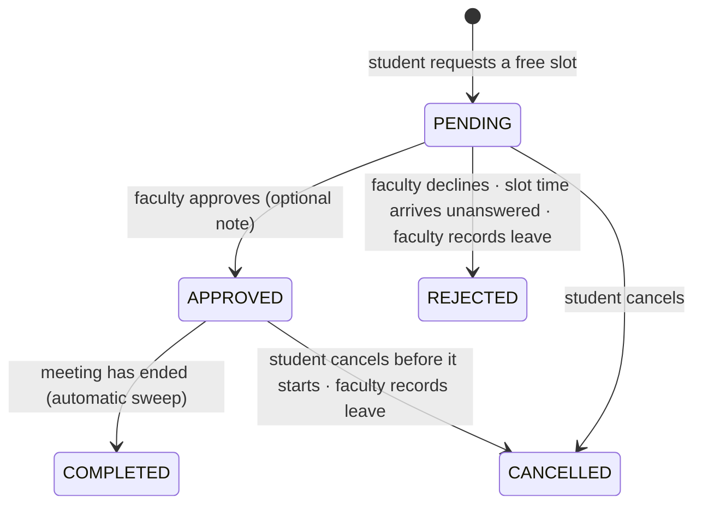

# Faculty Availability & Intelligent Appointment Scheduling System

**Project report — Advanced SQL & Modern Database Features, 5th semester, SRM Institute of Science and Technology**

## Abstract

Students at SRM often walk to a staff room to meet a faculty member and find them teaching, in a meeting or
already with another student. A faculty member with 500+ students, meanwhile, receives requests by phone,
message, e-mail and in person, with no single place to see or decide them. This project replaces that with a
web system in which students request a specific free slot, faculty approve or decline it, and an administrator
monitors the whole process.

The project's emphasis is the database. PostgreSQL 18 is not a passive store here: it **computes** which slots
are free (faculty office hours minus teaching, leave and existing appointments, and minus the student's own
classes), **enforces** every booking rule so that no code path can bypass them, **guarantees** that two
students can never obtain the same slot even when they submit at the same instant, **records** every change in
an append-only audit trail written by triggers, and **serves** statistics through window functions and a
materialized view. The system is delivered as a tested, documented monorepo (588 automated tests, 100 %
statement coverage) that starts with a single `docker compose up --build`.

## 1. Problem statement

| Who     | Problem today                                                                                         |
| ------- | ----------------------------------------------------------------------------------------------------- |
| Student | Travels to the staff room without knowing whether the faculty member is free; waits or returns later. |
| Student | Batches have different timetables, so a time that suits one student may clash with another's classes. |
| Faculty | Requests arrive through many channels; no overview of who needs what, and when.                       |
| Faculty | Leave or meetings silently invalidate meetings students thought they had.                             |
| College | No record of who met whom, how quickly requests are answered, or how demand is spread across faculty. |

## 2. Objectives

1. Let a student see a faculty member's **genuinely** free slots and request one with a purpose.
2. Let faculty maintain weekly office hours and one-off absences, and approve or decline requests.
3. **Never double-book a slot**, including under simultaneous requests.
4. Keep every business rule in force even for writes that bypass the application.
5. Make every important action traceable (who, what, when, before/after).
6. Give faculty and administrators live statistics without slowing the system as history grows.
7. Deliver it tested, documented and deployable in one command.

## 3. From the DBMS project to the Advanced SQL project

The question we expect in the review is _"How is this different from your DBMS project?"_ The answer is not
more tables or a nicer interface; it is what the database itself guarantees and computes.

| Concern              | Typical DBMS-course project                                 | This project                                                                                                                             |
| -------------------- | ----------------------------------------------------------- | ---------------------------------------------------------------------------------------------------------------------------------------- |
| Double booking       | `SELECT` to check, then `INSERT` (breaks under concurrency) | `EXCLUDE USING gist (faculty_id WITH =, slot WITH &&)` — PostgreSQL rejects the overlap atomically; proven with 4 concurrent connections |
| Availability         | Stored "free/busy" flags or computed in application code    | `faculty_free_slots()`: CTEs + `LATERAL generate_series` over office hours, minus teaching, leave, bookings and the student's classes    |
| Business rules       | In controllers (bypassable by any other client)             | CHECK constraints, a validation trigger with custom SQLSTATEs `AB001–AB008`, lifecycle trigger for status transitions                    |
| Time data            | Separate date and time columns                              | Range types (`tstzrange`, custom `timerange`), PostgreSQL 18 `WITHOUT OVERLAPS` temporal keys                                            |
| Concurrent decisions | Last write wins                                             | `SELECT … FOR UPDATE` row lock; SERIALIZABLE with automatic retry where a decision depends on what was read                              |
| History              | None, or manual log calls                                   | Generic audit trigger on 9 tables, same transaction, actor from transaction-local settings, append-only                                  |
| Side effects         | Application code remembers to notify                        | Triggers write notifications; recording leave releases affected appointments in the same transaction                                     |
| Reports              | `GROUP BY` on every page view                               | Window functions (`RANK`, `LAG`, running `SUM`, `DENSE_RANK`, `percentile_cont`) and a materialized view refreshed concurrently          |
| Performance          | Default indexes                                             | Partial GiST, expression B-tree, trigram GIN, BRIN — each justified with `EXPLAIN ANALYZE` on 60,000 appointments                        |
| Security             | Plain or weakly hashed passwords                            | bcrypt only (a CHECK rejects anything else), JWT, default-deny API, role checks, account status re-checked per request                   |
| Evidence             | Manual demo                                                 | 588 automated tests, including SQL-level, concurrency and browser tests                                                                  |

## 4. The system

### 4.1 Portals and features

| Portal  | Login                          | Features                                                                                                                                                                      |
| ------- | ------------------------------ | ----------------------------------------------------------------------------------------------------------------------------------------------------------------------------- |
| Student | Registration Number + password | Dashboard (counts, next approved meeting, recent activity) · search faculty · free slots by day with the purpose form · My Appointments by status, cancel · notifications     |
| Faculty | Employee ID + password         | Dashboard (today, pending, upcoming, approval rate, median response time, weekly chart) · approve/decline with a note · weekly office-hours editor · leave/meetings · history |
| Admin   | Admin ID + password            | Live dashboard · students, faculty and departments with activity · activate/deactivate accounts · appointment monitoring with filters · audit log · monthly reports           |

Demo accounts (created by the seed; only bcrypt hashes are stored):

| Portal  | Name          | Login ID         | Password       |
| ------- | ------------- | ---------------- | -------------- |
| Student | Priya Sharma  | `RA221100301001` | `Password123!` |
| Faculty | Prof. K. Rao  | `FAC200`         | `Password123!` |
| Faculty | Prof. S. Iyer | `FAC201`         | `Password123!` |
| Admin   | Amy           | `ADMIN001`       | `Admin123!`    |

### 4.2 Appointment lifecycle

The transitions are enforced by the `appointments_guard_update` trigger; an illegal transition (for example
approving a cancelled request) raises SQLSTATE `AB005`, which the API returns as
`409 INVALID_STATUS_TRANSITION`.

## 5. Architecture

- **Monorepo** (npm workspaces): `services/api` (Express 5, TypeScript), `apps/student|faculty|admin` (React 19,
  Vite, Tailwind CSS 4), `packages/ui` (shared components), `packages/api-client` (typed Axios client),
  `packages/types` (API contracts shared by both sides), `database/` (migrations, seed, benchmarks), `e2e/`.
- **API layering**: Router → Controller (HTTP only, zod validation) → Service (use cases, transactions) →
  Repository (hand-written parameterised SQL with node-postgres). No ORM: the SQL is the subject of the project.
- **Rule placement** — each rule lives where it cannot be bypassed, with friendly checks in front:

| Rule                          | Portal                 | API                                | PostgreSQL (the guarantee)                              |
| ----------------------------- | ---------------------- | ---------------------------------- | ------------------------------------------------------- |
| One slot, one active booking  | refreshes slots on 409 | maps `23P01` → `409 SLOT_CONFLICT` | exclusion constraint                                    |
| Slot must be offered and free | shows only free slots  | —                                  | `check_appointment_request()` trigger (`AB002`–`AB004`) |
| Purpose 10–500 characters     | form validation        | zod schema                         | CHECK constraint                                        |
| Status transitions            | shows valid actions    | row lock, ownership check          | lifecycle trigger (`AB005`)                             |
| Passwords                     | —                      | bcrypt hashing                     | CHECK: only a bcrypt hash can be stored                 |
| Audit                         | —                      | sets `app.user_id` per transaction | audit trigger (cannot be skipped)                       |

Details: [ARCHITECTURE.md](ARCHITECTURE.md), request flows: [SEQUENCE_DIAGRAM.md](SEQUENCE_DIAGRAM.md).

## 6. Database design

Twelve tables in seven ordered migrations ([DATABASE_DESIGN.md](DATABASE_DESIGN.md), [ER_DIAGRAM.md](ER_DIAGRAM.md)):

| Group      | Tables                                                                                             |
| ---------- | -------------------------------------------------------------------------------------------------- |
| People     | `departments`, `batches`, `users`, `students`, `faculty`                                           |
| Schedules  | `batch_schedule` (classes = teaching hours), `faculty_availability`, `faculty_schedule_exceptions` |
| Bookings   | `appointments`, `notifications`                                                                    |
| Operations | `audit_logs`, `schema_migrations`                                                                  |

Plus the view `appointment_details`, the materialized view `faculty_monthly_report`, and functions
`faculty_free_slots`, `check_appointment_request`, `process_elapsed_appointments`, `refresh_reports`,
`app_now` and `campus_timezone`.

Key decisions: users with role-specific subtype tables linked by a composite foreign key `(user_id, role)`,
so a `students` row can only point at a STUDENT user; slots as half-open `tstzrange [start, end)` so
back-to-back meetings do not overlap; weekly rows as time-of-day ranges in campus time, exceptions as absolute
instants; `uuidv7()` appointment ids (non-guessable yet index-friendly).

## 7. Advanced SQL features and the problem each solves

| Feature                                                                          | Problem                                                 | Where / evidence                                                     |
| -------------------------------------------------------------------------------- | ------------------------------------------------------- | -------------------------------------------------------------------- |
| Partial GiST **exclusion constraints**                                           | double booking by faculty or student, even concurrently | `appointments_no_double_booking`; `concurrency.sql.test.ts`          |
| **`WITHOUT OVERLAPS`** temporal keys (PG 18)                                     | overlapping office hours or classes                     | `faculty_availability`, `batch_schedule`; `schedules.sql.test.ts`    |
| Range types + custom `timerange`                                                 | overlap and containment of times                        | slots, exceptions, weekly windows                                    |
| **CTEs, `LATERAL`, `generate_series`**                                           | computing free slots in one statement                   | `faculty_free_slots()`; `free-slots.sql.test.ts`                     |
| PL/pgSQL functions + **triggers**                                                | rules and side effects no client can skip               | validation, lifecycle, notifications, leave release, audit           |
| Custom **SQLSTATE**s `AB001–AB008`                                               | precise, translatable errors from the database          | mapped to HTTP codes in `database-error.ts`                          |
| **Data-modifying CTEs**                                                          | two state transitions atomically, once a minute         | `process_elapsed_appointments()`                                     |
| **Row locking** `SELECT … FOR UPDATE`                                            | two decisions racing on one request                     | `AppointmentService`; HTTP race test                                 |
| **SERIALIZABLE** + automatic retry                                               | write skew in read-then-write logic                     | `withTransaction`; `transaction.test.ts`                             |
| Transaction-local settings (`set_config`)                                        | tell triggers who acts / what time it is                | audit actor, `app_now()` business clock                              |
| **Audit trigger**, append-only table, JSONB diff                                 | traceability                                            | `audit_logs`; admin Audit log page                                   |
| **Window functions** `RANK`, `LAG`, `SUM OVER`, `DENSE_RANK`, `count(*) OVER ()` | comparative statistics, ranking, totals with paging     | reports, admin dashboard, appointment monitor                        |
| Ordered-set aggregate `percentile_cont`                                          | typical response time robust to outliers                | faculty dashboard                                                    |
| `FILTER` aggregates, `generate_series` + `LEFT JOIN`                             | many counts in one pass; charts without gaps            | every dashboard                                                      |
| **Materialized view** + `REFRESH … CONCURRENTLY`                                 | fast reports that do not block readers                  | `faculty_monthly_report`; Reports page                               |
| **Indexes**: partial GiST, expression B-tree, trigram GIN, BRIN                  | each named query stays fast as data grows               | § 8 and `EXPLAIN ANALYZE` below                                      |
| **Keyset pagination**                                                            | deep pages of an ever-growing log                       | `GET /api/admin/audit`                                               |
| Advisory lock, checksummed migrations                                            | safe, repeatable schema changes                         | `Migrator`                                                           |
| CHECK constraints incl. regex and cross-column                                   | invalid data can never be stored                        | login-id format per role, bcrypt-only passwords, status ↔ timestamps |

## 8. Concurrency: the central demonstration

**The problem.** A "check, then insert" booking looks correct and passes every single-user test. Four students
who submit the same slot at the same moment all run the check before any of them inserts — so all four
succeed.

**The proof.** `services/api/test/integration/sql/concurrency.sql.test.ts` runs exactly that with four real
connections released by a barrier:

| Implementation                          | Result of 4 simultaneous requests                                                   |
| --------------------------------------- | ----------------------------------------------------------------------------------- |
| Naive check-then-insert (no constraint) | **4 bookings** of one slot                                                          |
| Exclusion constraint                    | **1 booking**; the other three wait for the first to commit, then fail with `23P01` |

The same guarantee is shown over HTTP (four logged-in students → one `201`, three `409 SLOT_CONFLICT`) and in
real browsers (`e2e/tests/03-double-booking.spec.ts`: two windows click "Request appointment" together; one
lands on "My appointments", the other is told the slot was just taken and sees fresh slots).

Why a constraint and not a lock or a stricter isolation level: the constraint is enforced by a GiST index
inside the insert itself, so it holds for every client (API, psql, a future mobile app), needs no application
coordination, and costs one index probe. Row locks are still used where they are the right tool — two
decisions on the same existing request — and SERIALIZABLE is used where a decision depends on what was read.

## 9. Performance

Measured with `EXPLAIN ANALYZE` on 60,000 appointments, 20,004 users and 100,061 audit rows
(full plans in [DATABASE_DESIGN.md § 8.1](DATABASE_DESIGN.md#81-query-performance-explain-analyze)):

| Query                      | Without the technique            | With it                                        |
| -------------------------- | -------------------------------- | ---------------------------------------------- |
| Availability check         | would scan the faculty's history | partial GiST index: 0.4 ms, history never read |
| Faculty history, latest 20 | sort 21,000 rows                 | expression index read backwards: 0.07 ms       |
| Name search `'%…%'`        | sequential scan ≈ 18 ms          | trigram GIN: 0.25 ms                           |
| Audit log, deep page       | `OFFSET 90000`: 13–30 ms         | keyset cursor: 0.02 ms                         |
| Monthly statistics         | live aggregation: 51–57 ms       | materialized view: 0.05 ms                     |

## 10. Security

bcrypt password hashes only (enforced by a CHECK constraint); login by Registration Number / Employee ID /
Admin ID with a per-portal role check; HS256 JWT with issuer, audience and expiry; every API route behind
default-deny authentication, with the account's role and active status re-read from the database on each
request (deactivation takes effect immediately); login rate limiting; parameterised SQL everywhere; helmet
security headers; password hashes never written to the audit trail; the example JWT secret refused in
production.

## 11. Testing

| Level                    | Tests | Highlights                                                                   |
| ------------------------ | ----: | ---------------------------------------------------------------------------- |
| API unit                 |   194 | services with fake repositories, middleware, error mapping, config           |
| SQL + database tooling   |   144 | every constraint, trigger and function; audit; concurrency; migrator; seeder |
| API over HTTP            |   111 | every endpoint, role and validation rule; race conditions                    |
| Client and UI components |   132 | typed client, shared components, every page of the three portals             |
| End to end (Playwright)  |     7 | cross-portal journeys in Chromium, including the simultaneous booking        |

Coverage: 100 % statements, functions and lines in every package. See [TESTING.md](TESTING.md).

## 12. Deployment

`docker compose up --build` starts PostgreSQL 18, the API (which migrates and seeds on first start) and the
three portals behind nginx on ports 8081–8083. See [DEPLOYMENT.md](DEPLOYMENT.md).

## 13. Demo walkthrough (≈ 10 minutes)

1. **Student** (<http://localhost:8081>, or 5173 in development): sign in as `RA221100301001`. Show the
   dashboard → Find faculty → Prof. K. Rao. Point out that slots already exclude Rao's classes and Priya's own
   batch timetable. Book a slot with a purpose; try a 5-character purpose first to show validation.
2. **Faculty** (8082 / 5174): sign in as `FAC200`. Dashboard → Requests → approve with a note. Show the weekly
   chart and approval statistics.
3. **Student**: the bell shows the notification; My appointments → Approved shows "Meet at Tech Park…" and the note.
4. **Double booking** — either two browser windows as the same student clicking **Request appointment** on the
   same slot together, or the automated proof:
   `cd e2e && npx playwright test tests/03-double-booking.spec.ts --headed` and
   `npm test --workspace @afb/api -- -t "Concurrent booking"`.
5. **Leave**: faculty → Availability → add Leave over the booked slot → "1 appointment was released"; the
   student sees it declined with the reason.
6. **Admin** (8083 / 5175): sign in as `ADMIN001`. Dashboard (live counts, ranking) → Audit log filtered to
   `appointments` / `UPDATE` shows who approved and what changed → Reports → **Refresh now** → Students →
   deactivate Priya and show that her open session ends on the next click; reactivate.
7. **SQL** (optional): run `database/benchmarks/explain.sql` on the benchmark database to show index use, and
   `SELECT * FROM faculty_free_slots(...)` directly in psql.

## 14. Limitations and future work

- Accounts, departments, batches and timetables are loaded from college records (seed/SQL import); there is
  no registration or timetable-editing screen.
- Notifications are in-app (polled every 30 s); e-mail or push delivery would be a separate worker reading the
  same `notifications` table.
- Slot length is fixed per faculty member (15 or 20 minutes); variable-length meetings would only change
  `faculty_free_slots()` and the length check.
- One campus time zone (Asia/Kolkata) is assumed throughout, by design.
- The monthly report is refreshed on demand; a scheduled refresh (e.g. `pg_cron`) is a one-line addition.

## 15. Conclusion

The system solves a real campus problem, but its value as an Advanced SQL project lies in where the
guarantees live. Correctness under concurrency comes from an exclusion constraint, not from careful
application code; availability is computed by the database from the actual schedules; every rule survives any
client; every change is audited in the same transaction; and statistics stay fast because the right index or a
materialized view serves each query — all demonstrated by automated tests and measured with `EXPLAIN ANALYZE`.
