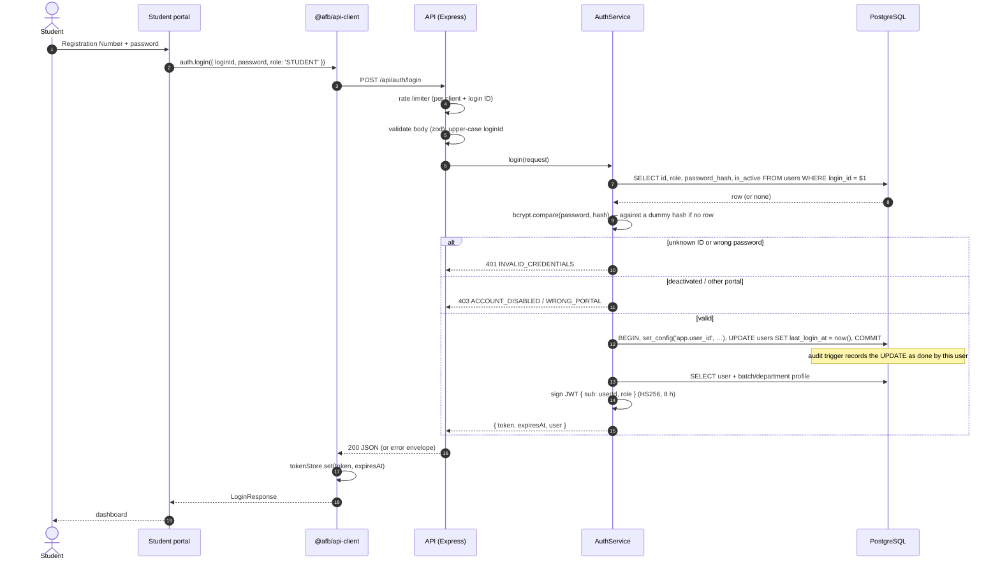
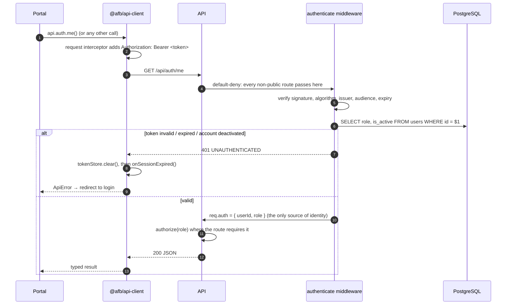
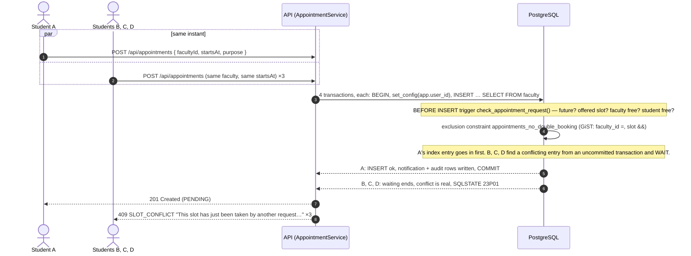
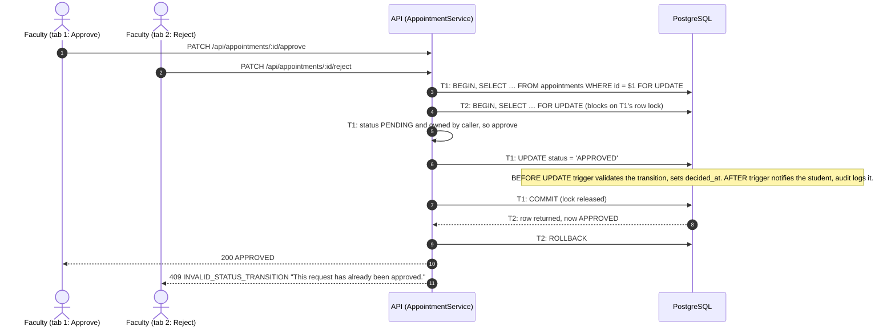

# Sequence Diagrams

Each diagram shows a real flow through the code, from the portal to PostgreSQL.

## 1. Login

## 2. Any authenticated request

## 3. Booking a slot — four students at the same instant

## 4. Approving a request while another decision races it

